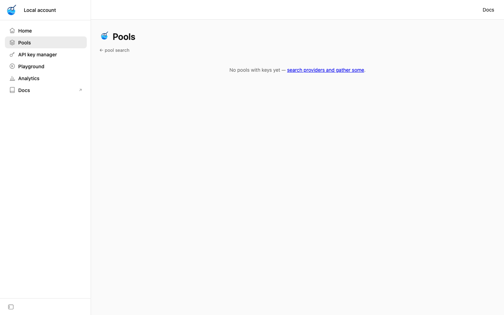
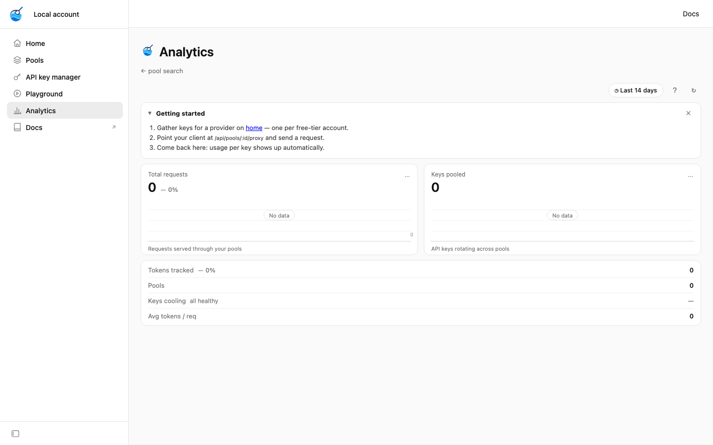
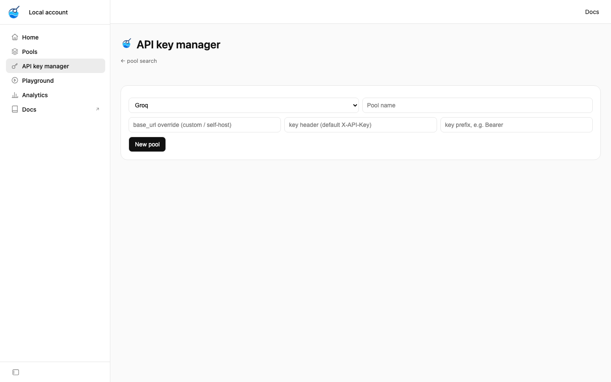
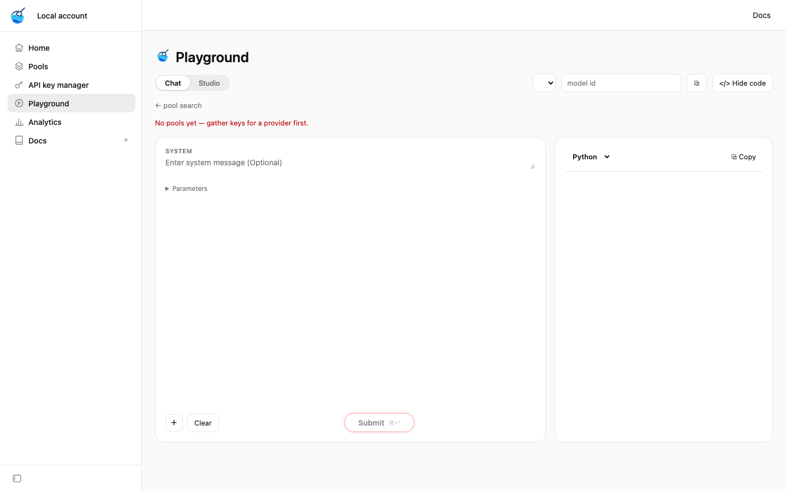

<p align="center">
  
</p>

<h1 align="center">pool-anything</h1>

<p align="center"><b>Gather free-tier API keys into one pool. Rotate through them automatically.</b></p>

<p align="center">
  <a href="https://github.com/Parithosh-Varma/pool-anything/actions/workflows/ci.yml"></a>
  <a href="LICENSE"></a>
  <a href="https://nodejs.org"></a>
  <a href="tsconfig.json"></a>
  <a href="package.json"></a>
</p>

<p align="center">
  🌐 <a href="https://pool-anything.pages.dev"><b>Landing page</b></a>
  ·
  🖥️ <a href="https://pool-anything-tools.pages.dev"><b>Live demo: tools UI</b></a>
  ·
  📖 <a href="https://pool-anything.pages.dev/docs"><b>Docs</b></a>
</p>

<hr />

Most AI/API providers hand you a free tier: a rate limit, a daily quota, a handful of trial tokens. One key's worth is small — but *several* keys, rotated, adds up. **pool-anything** lets you gather N keys for the same provider into a pool, then serves them through a single endpoint that rotates across them with the strategy you choose and tracks usage per key.

- 🔁 **13 rotation strategies** — round-robin by default; random, weighted, least-loaded, sticky, tiered, shuffle-sharded, and more
- 📊 **Usage & quota tracking** — per-key and per-pool token counts in SQLite
- 🌐 **Drop-in HTTP proxy** — point your client at pool-anything; it forwards with the right key, header, and auth scheme
- ☁️ **Cloudflare Workers build** — same API on a free-plan SQLite Durable Object, with the hosted UI pointed at it via `?api=`
- 🔌 **36 providers preconfigured** — Groq, OpenRouter, Gemini, OpenAI, Anthropic, and more (plus any custom provider)
- 🖥️ **Built-in web UI** — search providers, gather keys, watch usage on the Analytics dashboard
- 🧰 **Dependency-free server core** — the proxy, API, and web UI run on Node built-ins + `node:sqlite` only; the interactive shell adds Ink + React

## Quick start

### Run it globally (recommended)

```bash
npm install -g pool-anything
pool-anything
```

That's it — an interactive assistant shell opens (`pool-anything >`). Type plain language like `list pools`, `add keys to groq`, or `show usage for groq`; type `.help` for all commands, `exit` to quit. Data (SQLite) lives in `~/.pool-anything/` so it works from any directory and survives upgrades.

```bash
pool-anything serve --port 4000 --open   # web UI + API on :4000, open the browser
pool-anything "list pools"               # run one command without the shell
pool-anything "update"                   # upgrade to the latest version (also an Update pill in the web UI header)
pool-anything "uninstall"                # remove the global CLI (shell only, asks to confirm)
echo "gsk_abc" | pool-anything -e "add keys to groq"   # pipe keys in
pool-anything --help                     # all options (serve, -e/--exec, -p/--port, -H/--host, --db, --data-dir, --open)
```

### Assistant shell

No subcommands to memorize — just say what you want:

| Say | It does |
| --- | --- |
| `list pools` | All pools with key counts + usage |
| `show usage for groq` | Token usage, quota, per-key breakdown |
| `add 5 keys to groq` | Paste keys, one per line (blank line finishes) |
| `create pool Prod Groq for groq` | Make a new pool |
| `watch groq` | Live usage, 2s refresh (`q` exits) |
| `next for groq` / `consume 100 on groq` | Rotate / record usage |
| `serve` | Start the web UI + API from inside the shell |
| `update` (or `/update`) | Check npm and upgrade to the latest version |
| `uninstall` (or `/uninstall`, CLI only) | Remove the global CLI (asks to confirm; pools/keys in SQLite stay) |

Keys always print masked (`gsk_…ab`); misunderstood input gets a "Did you mean …?" nudge. The shell is a rich terminal UI (colors, bordered panels, live `watch` view, `↑`/`↓` history) with a plain-text fallback when Ink can't initialize.

### Run from source

```bash
git clone https://github.com/Parithosh-Varma/pool-anything.git
cd pool-anything
npm install
npm run dev
```

Open **http://localhost:3000** (after `pool-anything serve`), search for a provider (try `groq`), paste one or more API keys, and hit **Gather**. Your pool is live. Prefer the terminal? The shell does it without a browser: `create pool Prod for groq`, then `add keys to groq`.

Then proxy a request through it straight from `curl` (every proxy call reports the `key_id` that served it, so you can see keys take turns):

```bash
# Pick the next key from pool 1 (round-robin)
curl http://localhost:3000/api/pools/1/next

# Proxy a request — pool-anything injects the key + auth header
curl -X POST http://localhost:3000/api/pools/1/proxy \
  -H 'content-type: application/json' \
  -d '{"path": "/chat/completions", "method": "POST",
       "body": {"model": "llama-3.3-70b", "messages": [{"role": "user", "content": "hi"}]},
       "tokens": 25}'
```

## How it works

```
                ┌──────────────────────────────────────────┐
   your app ───▶│  POST /api/pools/:id/proxy               │
                │                                          │
                │  1. nextKeyRaw()  → strategy pick       │
                │  2. inject key    → header / query param │
                │  3. forward       → provider baseUrl     │
                │  4. record usage  → SQLite (per key)     │
                └──────────────────────────────────────────┘
                     │              │              │
                     ▼              ▼              ▼
                  key 1          key 2     …    key N
                  (Groq)         (Groq)         (Groq)
```

A **pool** is a named group of keys for one provider. Rotation is a simple cursor over the key list (`cursor % keys.length`), so keys are used evenly. Usage rows record how many tokens each key consumed, and `/usage` rolls that up per key and per pool against the provider's quota.

## Screenshots

| Pools | Analytics |
| --- | --- |
|  |  |

| Key manager | Playground |
| --- | --- |
|  |  |

## API reference

All responses are JSON. `:id` is a pool ID.

### Providers

| Method | Path | Description |
| --- | --- | --- |
| `GET` | `/api/providers` | List all known providers (id, name, quota, hints) |

### Pools

| Method | Path | Description |
| --- | --- | --- |
| `GET` | `/api/pools` | List all pools |
| `POST` | `/api/pools` | Create a pool — `{ provider, name, base_url?, key_header?, key_prefix?, strategy? }` |
| `PATCH` | `/api/pools/:id` | Update a pool — `{ strategy }` (`""` clears back to the global default) |
| `GET` | `/api/pools/:id` | Pool summary: key count, strategy, usage, quota, per-key breakdown |
| `DELETE` | `/api/pools/:id` | Delete a pool and its keys + usage |
| `GET` | `/api/pools/:id/next` | Rotate: return the next key (masked — never the raw key). `?sticky=<session>` forces sticky selection |
| `POST` | `/api/pools/:id/consume` | Record usage — `{ tokens: <positive int ≤ 1000000>, key_id?, sticky? }` (with `key_id`, bills that key without rotating) |
| `GET` | `/api/pools/:id/usage` | Usage rollup — `{ used, usedInWindow, quota, quotaWindow, remaining, perKey }` (`used` is lifetime; `remaining`/`usedInWindow`/`perKey` are windowed for monthly quotas) |
| `GET` | `/api/pools/:id/calls?limit=` | Recent upstream attempts — status, tokens, response body (4000 chars text, ~2MB retained media), per key (default 50, max 200) |
| `POST` | `/api/pools/:id/proxy` | Proxy a request through the pool (see below) |

### Keys

| Method | Path | Description |
| --- | --- | --- |
| `GET` | `/api/pools/:id/keys` | List keys (masked) |
| `POST` | `/api/pools/:id/keys` | Add a key — `{ label, api_key, info?, weight?, priority? }` |
| `GET` | `/api/pools/:id/keys/:keyId` | Fetch one key (raw) |
| `PATCH` | `/api/pools/:id/keys/:keyId` | Update label / api_key / info / weight / priority |
| `DELETE` | `/api/pools/:id/keys/:keyId` | Remove a key |

### Proxy request body

```jsonc
{
  "path": "/chat/completions",   // path appended to the provider baseUrl
  "method": "POST",              // HTTP method (default POST)
  "body": { "…": "…" },          // JSON body, forwarded as-is
  "headers": { "…": "…" },       // extra headers (override defaults)
  "tokens": 25,                  // optional: usage to record for this call
  "sticky": "user-42"            // optional: same as X-Pool-Sticky header
}
```

`POST /proxy/:id` is an alias for `POST /api/pools/:id/proxy`.

The response reports which key was used and the upstream status:

```json
{
  "key_id": 3,
  "label": "key 1",
  "masked": "gsk_…ab",
  "status": 200,
  "body": "{ … upstream response, first 4000 chars … }"
}
```

### Health

| Method | Path | Description |
| --- | --- | --- |
| `GET` | `/health` | Liveness check → `ok` |
| `GET` | `/api/db/ping` | SQLite reachability → `{ ok: true }` |
| `GET` | `/api/analytics` | Totals + 7-day deltas + 14-day daily series (drives the dashboard) |

### Version, update & crawler files

| Method | Path | Description |
| --- | --- | --- |
| `GET` | `/api/version` | Current vs latest npm version + `updateAvailable` (drives the header Update pill) |
| `POST` | `/api/update` | Self-update via `npm install -g pool-anything@latest` (needs `POOL_API_TOKEN` bearer when auth is on) |
| `GET` | `/robots.txt` | Allows all crawlers, points at the sitemap |
| `GET` | `/sitemap.xml` | XML sitemap: static routes + one `/provider/:id/` entry per provider |

## Web UI

| Route | Page |
| --- | --- |
| `/` | Provider search + setup panel + Analytics dashboard |
| `/provider/:id` | Gather keys for one provider, per-key usage, proxy snippet |
| `/pools` | Pools holding keys, with usage |
| `/keys` | API key manager — add, view, edit, remove keys |
| `/playground` | Chat + image playground against a pooled key |
| `/analytics` | Analytics dashboard (totals, 7-day deltas, 14-day charts) |
| `/history` | Upstream call history — status, tokens, generated media |
| `/docs` | Redirect → canonical docs on Cloudflare Pages |

The home page also shows an Analytics dashboard driven by `GET /api/analytics`; the same dashboard lives on its own `/analytics` page.

### Hosting the UI on Cloudflare Pages

The same UI ships as a static site ([pool-anything-tools](https://pool-anything-tools.pages.dev), `pool-anything-tools` Pages project) that talks to a backend you run anywhere:

```bash
npm run export:tools   # builds tools-site/ from src/admin
npx wrangler pages deploy tools-site --project-name pool-anything-tools
```

Pushes to `main` redeploy automatically via [pages-tools.yml](.github/workflows/pages-tools.yml); locally, `npm run tools:daemon` watches `src/admin` and redeploys on every save.

Open the Pages URL with `?api=https://your-backend` once (or use the Backend pill, bottom-left) to point it at your server. If the backend sets `POOL_API_TOKEN`, prefer the Backend pill for the token; `?token=…` works but places the bearer in the URL (server logs/history). The server only sends CORS headers to the hosted Pages origins, `http://localhost` dev, and `ALLOWED_ORIGINS`, so cross-origin calls work without exposing the API to arbitrary sites. Keys stay on your backend — the Pages site is UI only.

### Running the backend on Cloudflare Workers

A Workers build lives in [`worker/`](worker/README.md). It exposes the same `/api/*` contract, keeps the Node server unchanged, and stores all state in one SQLite-backed Durable Object — free-plan eligible, with no D1 database to create.

```bash
npm run dev:worker       # local Workers runtime
npx wrangler deploy      # deploy Worker + Durable Object
npx wrangler secret put POOL_API_TOKEN
```

Point the hosted UI at it with `?api=https://your-worker.workers.dev`, then paste the token into the Backend pill. `GET /ui` on the Worker builds that URL for you. See [`worker/README.md`](worker/README.md) for limits, configuration, and troubleshooting.

## Configuration

| Variable | Default | Purpose |
| --- | --- | --- |
| `HOST` | `127.0.0.1` | Interface to bind (loopback by default; no auth, so keep it local) |
| `PORT` | `3000` | Main server port |
| `POOL_API_TOKEN` | _(unset)_ | Bearer token gate for raw-key reads, writes, rotation, and proxy |
| `ALLOWED_ORIGINS` | Pages hosts | Comma-separated CORS allowlist for browser API reads (default: `pool-anything-tools.pages.dev`, `pool-anything.pages.dev`; `http://localhost`/`127.0.0.1` always allowed; set explicitly when self-hosting the UI) |
| `LOCAL_DB_PATH` | `data/pool-anything.db` (checkout) / `~/.pool-anything/*.db` (global) | SQLite database location (exact file; `--db` flag equivalent) |
| `POOL_DATA_DIR` | _(unset)_ | Data directory holding the SQLite file (`<dir>/pool-anything.db`; `--data-dir` flag equivalent) |
| `PROXY_TIMEOUT_MS` | `30000` | Per-attempt upstream timeout for `/proxy` |
| `POOL_DEBUG` | _(unset)_ | `1` logs per-request proxy traces (`[proxy] METHOD path pool=N tried=[...]`) to stderr — no bodies/keys; playground also keeps a per-session Debug log pane |
| `ALLOW_PRIVATE_UPSTREAM` | _(unset)_ | `1` disables SSRF protections — tests/loopback only, never in prod |
| `POOL_ROTATION_STRATEGY` | `round-robin` | Default key-selection strategy for pools that don't set their own. An unknown value fails at startup and lists the valid names. See [Rotation strategies](#rotation-strategies) |
| `POOL_ROTATION_OPTIONS` | _(unset)_ | JSON options for the active strategy, e.g. `{"time-based":{"everyN":50},"shuffle-shard":{"shardSize":2}}`. Malformed JSON is ignored with a warning, not a crash |

Providers are defined in [`data/providers.json`](data/providers.json). See [CONTRIBUTING.md](CONTRIBUTING.md#adding-a-provider) for the schema — adding a provider is a one-line JSON edit, no code changes.

## Rotation strategies

Which key serves the next request. Round-robin is the default and behaves exactly as it always has; everything else is opt-in per pool or globally. Cooldown and quota filters run first (`eligibleKeys`), so every strategy only ever chooses from keys that are currently usable.

| Strategy | Picks | Use it when |
| --- | --- | --- |
| `round-robin` | Cursor over the eligible list | Default. An even spread with no extra state. |
| `random` | Uniform random | An even spread without a predictable sequence. |
| `weighted-random` | Random, proportional to `weight` | Keys have different capacity; a paid key should take more traffic. |
| `weighted-round-robin` | Key furthest below its `picks / weight` share | Same capacity goal as weighted-random, but deterministic and smoothly interleaved. |
| `least-connections` | Fewest in-flight requests | Request latency varies; avoid piling work onto one key. |
| `least-used` | Fewest assigned requests (`picks`) | Long-run balance regardless of recency. |
| `least-recently-used` | Oldest `last_used_at` | Spread by time so no key runs hot. |
| `sticky` | Rendezvous hash of session + key id | A session must keep hitting the same key (per-user limits, caches, upstream state). |
| `power-of-two` | Two random samples, take the less loaded | Near-optimal load balance with no state or full scan. |
| `tiered` | Best `priority` tier, round-robin within it | Free keys first, paid keys as overflow (lower number wins). |
| `shuffle-shard` | Random (or session-stable) subset, least loaded inside it | Isolate a bad key's blast radius: it can only touch sessions in its shard. |
| `time-based` | Park on one key for `everyMs` / `everyN` | Exploit upstream caches or per-key warm-up. |
| `health-aware` | Round-robin over keys under the failure breaker | Some keys are flaky; prefer clean streaks before cooldown kicks in. |

### Configuring

```bash
# Global default for every pool that doesn't set its own.
POOL_ROTATION_STRATEGY=sticky

# Per-strategy tuning (all values are non-negative numbers).
POOL_ROTATION_OPTIONS='{"health-aware":{"breakerAfter":5},"time-based":{"everyMs":30000,"everyN":50},"shuffle-shard":{"shardSize":2}}'
```

| Option | Default | Meaning |
| --- | --- | --- |
| `health-aware.breakerAfter` | `5` | Skip a key once its consecutive-failure count reaches this; if every key is at or above it, fall back to all keys. |
| `time-based.everyMs` | `30000` | Rotate after parking this long. `0` disables the time limit. |
| `time-based.everyN` | `50` | Rotate after this many requests. `0` disables the request limit. |
| `shuffle-shard.shardSize` | `2` | Keys per shard (clamped to the eligible key count). |

```bash
# Per pool, at creation or afterwards.
curl -X POST localhost:3000/api/pools -H 'content-type: application/json' \
  -d '{"provider":"groq","name":"main","strategy":"least-used"}'

curl -X PATCH localhost:3000/api/pools/1 -H 'content-type: application/json' \
  -d '{"strategy":"tiered"}'
```

```sql
UPDATE pools SET strategy = 'time-based' WHERE id = 1;
```

Weights are per key. `0` means never picked by **any** strategy, unless every key in the pool is `0`, in which case selection degrades to uniform rather than failing. `priority` only affects `tiered`.

```sql
UPDATE pool_keys SET weight = 3 WHERE id = 7;    -- 3x the traffic
UPDATE pool_keys SET priority = 1 WHERE id = 8;  -- paid overflow tier
```

```bash
curl -X POST localhost:3000/api/pools/1/keys -H 'content-type: application/json' \
  -d '{"label":"paid","api_key":"sk-…","weight":5,"priority":1}'
```

### Sticky routing is stateless

`sticky` stores **no session map**. It rendezvous-hashes: for a given session key it scores every eligible key by hashing `sessionKey + keyId` and takes the highest score.

That buys three things a stored map cannot:

- **No growth.** No table to grow, no eviction or TTL to get wrong.
- **No session writes.** There is no row per session to insert or expire; the per-key `picks` / `last_used_at` counters are touched on every pick, as for any strategy.
- **No reshuffling.** When a key is removed or cooled down, only *its* sessions move — to their second-highest scoring key. Everyone else stays put, including across restarts, because the hash is a pure function of two strings.

The trade-off: a cooled-down key's sessions move off it and move back when it rejoins. That brief flap is inherent to having no state. If you need sessions to sit still through a blip, use `health-aware` instead.

Pass the session key as the `X-Pool-Sticky` header on `/proxy`, or `?sticky=` on `/next`:

```bash
curl localhost:3000/proxy/1 -H 'X-Pool-Sticky: user-42' -d '{"path":"/chat/completions", …}'
curl 'localhost:3000/api/pools/1/next?sticky=user-42'
```

Omit it and the pool uses its own strategy. The key is never derived from `POOL_API_TOKEN`, so sharing one token does not silently pin every caller to the same key.

`shuffle-shard` reuses the same session key: with one, a session's shard is stable and failover attempts hash to fresh shards; without one, each request samples a new shard.

### State and multi-process notes

- `picks`, `last_used_at`, `weight`, and `priority` live on `pool_keys`; the round-robin cursor and time-based parking anchor live on `pools`. All survive restarts.
- `least-connections` counts in-flight requests **in process memory**, because "in flight" is meaningless across a restart. With multiple server processes against one SQLite file, it sees only its own traffic.
- `time-based` writes its anchor to `pools.strategy_state` on each request so a restart doesn't reset the parking window.

### Adding a strategy

One `case` in `selectKey` in [`src/pool/strategy.ts`](src/pool/strategy.ts), plus its name in `STRATEGY_NAMES`. A strategy is a pure synchronous function of the already-filtered candidate list plus a context (cursor, rng, options, state), so it needs no DB access and is unit-testable on its own. Cooldown and quota filtering stays in `eligibleKeys()`; strategies only narrow further.

## Project structure

```
src/
  server.ts          Thin HTTP front door (delegates to router/admin/observability)
  cli.ts             Entry dispatch: assistant shell (default) vs `serve` vs one-shot
  version.ts         Version check, self-update, uninstall (shared by CLI + web UI)
  cli/               Interactive shell — commands.ts (presentation-free core), nl.ts (parser), ui.ts (text rendering), repl.ts (plain fallback + one-shot), tui.tsx (Ink shell)
  admin/             Web UI — pages.ts, components.ts, shell.ts (nav/CSS/JS), branding.ts, seo.ts (robots/sitemap), tokens.ts (design tokens)
  router/api.ts      Route matchers + abuse caps (MAX_POOLS / MAX_KEYS_PER_POOL)
  middleware/auth.ts Bearer auth for raw keys, writes, rotation, proxy (POOL_API_TOKEN)
  common/http.ts     JSON body + hardened JSON responses
  config/            env.ts (PORT, HOST, POOL_API_TOKEN, DB path, timeouts) + paths.ts (package root, data dirs)
  db/                SQLite helpers + init script
  pool/index.ts      Providers, quotas (monthly + daily), usage, analytics (SQLite)
  pool/rotation.ts   Eligibility, strategy dispatch, cooldown, multi-window quota enforcement
  pool/strategy.ts   Pure key-selection strategies + option/state parsing
  pool/inflight.ts   In-process in-flight counters for least-connections
  proxy/forward.ts   Upstream forwarding + literal-IP SSRF guard + failover cap
  proxy/dns.ts       DNS rebinding guard (resolve + reject private IPs)
  upstream/index.ts  Per-key auth injection (single + multi-field credentials)
  playground/adapters.ts  Playground provider adapters (paths, body shapes, output parsing)
  media/capabilities.ts   Multimodal capability map + provider message builders
  observability/health.ts  /health, /api/db/ping, /api/analytics handlers
worker/
  README.md          Workers deploy, limits, config, and UI setup
  src/index.ts       Thin Worker entry → singleton Durable Object
  src/durable.ts     PoolDB Durable Object + D1-shaped SQLite adapter
  src/app.ts         HTTP router and API validation (same routes as Node)
  src/db.ts          SQL schema, CRUD, quota and rotation
  src/proxy.ts       Buffered edge proxy with failover
scripts/
  export-tools-ui.ts Static export of the admin UI for Cloudflare Pages
  tools-api-base.js  Backend shim (configurable API base + token)
  tools-watch.ts     Watch daemon: re-export + redeploy on save
  check-tokens.ts    Verify src/admin/tokens.ts matches design-tokens.json
  copy-assets.mjs    Build step: copy non-TS assets into dist/
  smoke.sh           Local smoke test against a running server
tests/
  unit/              12 files — rotation, strategies, quota, analytics, calls, env, upstream, CLI
  integration/       6 files — proxy, pages, home, adapters, multimodal (89 tests total, `npm test`)
data/
  providers.json     36 preconfigured providers
  pool-anything.db   SQLite database (git-ignored)
public/logos/        Provider logos
design-tokens.json   Canonical token values (checked by scripts/check-tokens.ts)
```

A few more things worth knowing about:

- [`examples/proxy-groq-models.sh`](examples/proxy-groq-models.sh) — list Groq models through a pool from a shell script.
- [`docs/adr/0001-pool-proxy.md`](docs/adr/0001-pool-proxy.md) — design record for rotation, failover, and quota enforcement.
- [`design-system.md`](design-system.md) — the token/component rules the web UI follows.

## Development

```bash
npm run dev          # watch mode, http://localhost:3000
npm run typecheck    # tsc --noEmit (Node + Worker)
npm run build        # compile to dist/
npm run start:dist   # run the compiled output
npm run db:init      # initialize the local database
npm run dev:worker   # local Workers runtime (wrangler)
npm test             # unit + integration suites (tests/unit, tests/integration, tests/worker)
npx tsx scripts/check-tokens.ts  # verify src/admin/tokens.ts against design-tokens.json
./scripts/smoke.sh   # smoke test against a running server (base URL as $1)
```

## Security notes

- Keys are stored in a local SQLite file (`data/pool-anything.db`), which is **git-ignored** — never commit it.
- List endpoints return **masked** keys (`gsk_…ab`); raw keys are only returned by the single-key `GET`.
- The server binds `127.0.0.1` by default; set `HOST` to another interface only behind your own auth layer.
- Without `POOL_API_TOKEN` there is **no authentication** — run it locally or behind your own auth layer, and don't expose it publicly with real keys inside.
- A public Workers deployment **must** set `POOL_API_TOKEN`; there is no loopback default at the edge. Use `wrangler secret put`, never a committed `vars` entry.

## Contributing

Read [CONTRIBUTING.md](CONTRIBUTING.md) before opening a PR, [SECURITY.md](SECURITY.md) to report a vulnerability, and [CODE_OF_CONDUCT.md](CODE_OF_CONDUCT.md) for community norms.

Questions? Ask in [GitHub Discussions](https://github.com/Parithosh-Varma/pool-anything/discussions).

## License

Licensed under the [Apache License 2.0](LICENSE).
